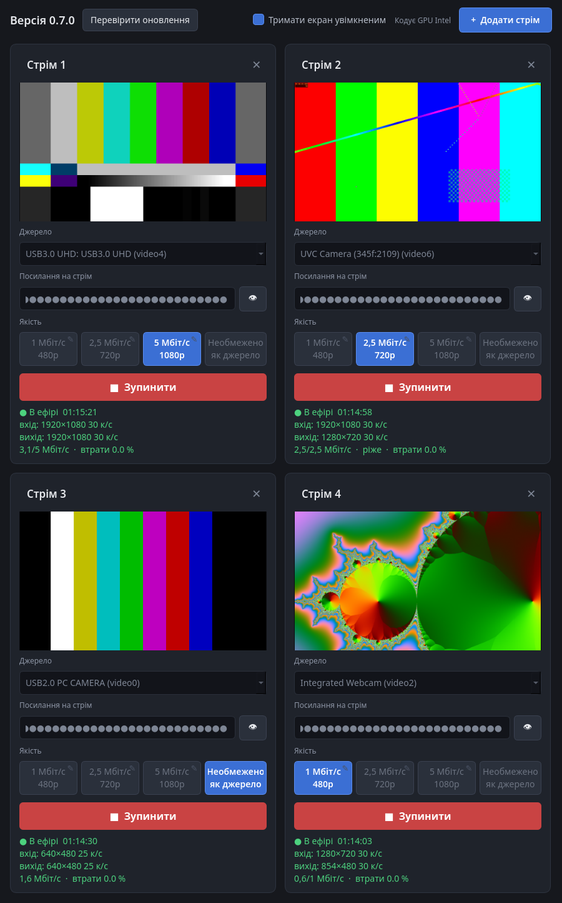

# eazy_streamer



## Для чого

Програма для зручного стрімінгу відразу з багатьох джерел. Акцентовано на карти відеозахвату, наприклад з fpv перехватів, чи дистанційних точок запуску.

Максимально просто, мінімалістично, проте потужно. Дбали про оптимізацію навіть для найслабших пк (бажано лінукс). Пофіксили деякі баги дешевих карт відеозахвату, особливо коли у вас відео ок, а на платформі куди стрімите - лагає.

Також подбали про стабільність і надійність. Якщо ви висмикнете карту відеозахвата з гнізда і вставите назад - стрім продовжиться. Закриття програми, лаги, кіт що смикнув дріт, втрата картинки - карта відеозахвата лишається прив'язаною до стріма. Єдине що вартує пам'ятати -- якщо висмикнули, то повернути бажано в те саме гніздо.

Робив як для себе, бо сам і використовую.

А далі Клод опише всю технічну сторону:

## Встановлення

### Debian 13

```bash
sudo apt install git ffmpeg python3-pyside6.qtwidgets
git clone https://github.com/Kargevon/eazy_streamer.git
./eazy_streamer/eazy-streamer
```

У шапці вікна написано, хто кодує відео. «Кодує GPU» — добре. «Кодує CPU» — відеокарта не підхопилась, і процесору буде важко.

На Intel 7-го покоління це лікується драйвером з `non-free`. У `/etc/apt/sources.list` після `main` дописати `non-free`, далі:

```bash
sudo apt update
sudo apt install intel-media-va-driver-non-free
```

На 12-му поколінні працює одразу. Інші не пробували.

### Windows 10, 11

Архів лежить у [Releases](https://github.com/Kargevon/eazy_streamer/releases/latest). Розпакувати, запустити `EazyStreamer.exe`. Ставити нічого не треба, Python і ffmpeg уже всередині. На диску займає 170 МБ.

Якщо Windows лякає синім вікном — «Докладніше», потім «Виконати».

Кодує NVIDIA, Intel або AMD, що знайдеться першим. Якщо «Кодує CPU» — оновити драйвер відеокарти.

## Заміри

Kargevon змушував Claude упарюватись на оптимізації: має на любе голубе працювати, якщо сама система не заважає.

Цифри з журналів програми. CPU — частка одного ядра на один стрім.

Dell Inspiron 15, i3-7020U (2 ядра), Intel HD 620, 8 ГБ, Debian. П'ять стрімів одночасно, версія 0.4.3:

| Джерело | В ефір | Кадри | CPU |
|---|---|---|---|
| HDMI-захват MS2130, USB 3 | 1080p, 4,5 Мбіт/с | 29,3 | 24 % |
| HDMI-захват MS2109, USB 2 | 1080p, 4,5 Мбіт/с | 30,0 | 31 % |
| вебкамера | 720p, 2,5 Мбіт/с | 30,0 | 18 % |
| аналоговий захват | 480p, 1 Мбіт/с | 25,0 | 11 % |
| тестова картинка | 720p, 2,5 Мбіт/с | 30,0 | 27 % |

Уся машина зайнята наполовину.

Dell XPS, i7-1280P, Debian. Один стрім 1080p з MS2130: 20 % ядра.

Windows 11, i5-12450H, RTX 3050. Один стрім з аналогового захвату, версія 0.5.8: 8 % ядра, машина зайнята на 4 %.

## FAQ

Звук? Немає.

Обрав 1080p, а в ефірі 480p. Картинку не розтягуємо: скільки дає джерело, стільки й іде.

Чому 25 кадрів, а не 30? Те саме: аналогове відео дає 25, стільки й передаємо.

Як перевірити посилання без карти? У списку джерел є «Тестова картинка».

Як оновити? Кнопка в шапці.

Де журнал? Debian: `~/.local/state/eazy_streamer/`. Windows: тека `logs` поруч з exe. Більше 20 МБ не виросте, ключів стрімів у ньому немає.

Де налаштування? Debian: `~/.config/eazy_streamer/streams.json`. Windows: тека `data` поруч з exe. Там посилання з ключами, нікому не давати.
